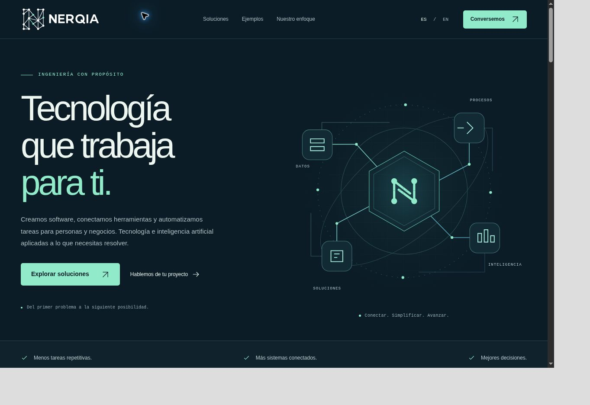

# Validación de identidad NERQIA V1.0

Fecha: 27 de octubre de 2026. Base inspeccionada: `main` en `71b404789debf1383753bdde97c03683cad4529b`, que ya integra las mejoras de UX y conversión del PR anterior. Rama: `feat/nerqia-brand-identity-integration`.

## Inspección y alcance

Se revisaron componentes Header/Footer/Icon/Network, tokens, configuración de sitio y productos, ES/EN, formulario local, prerenderizado, HTML inicial, favicon, Open Graph y el workflow de Pages. No había manifest ni sistema de identidad definitivo. El `Brand` provisional se sustitye por `BrandLogo`; no se mantiene una segunda implementación.

Se conservan contenido comercial, idiomas, secciones, navegación, CTA, productos ocultos, contacto y privacidad. En el hero solo cambia la N provisional del centro de la ilustración. Se mantienen framework, workflow, dominio, animaciones y estructura general. El CSS se limita a dimensiones de la marca y sus enlaces; el acento menta se actualiza en los tokens existentes y la página 404 los reutiliza.

## Verificaciones automáticas

| Comprobación                         | Resultado local                                          |
| ------------------------------------ | -------------------------------------------------------- |
| `npm ci` con lockfile actualizado    | Correcto                                                 |
| `npm run brand:generate`             | 31 recursos generados                                    |
| `npm run brand:check`                | 31 salidas idénticas a sus maestros; integridad correcta |
| `npm run lint`                       | Correcto, sin advertencias de lint                       |
| `npm run typecheck`                  | Correcto                                                 |
| `npm test`                           | 40 pruebas, 4 archivos, correctas                        |
| `npm run build` sin URL pública      | Correcto; no inventa canonical ni sitemap                |
| Build con URL y base `/nerqia-site/` | Correcto, ES/EN y rutas verificadas                      |
| `npm run check`                      | Correcto, incluye las verificaciones anteriores          |
| `git diff --check`                   | Correcto                                                 |

Las 30 pruebas anteriores se conservan. Las 10 nuevas cubren selección de las cuatro variantes, ambos fondos, proporción/dimensiones, instancias decorativas sin IDs, enlaces de inicio accesibles en ambos idiomas, rutas de Pages, integridad de recursos y reproducción byte a byte.

Las verificaciones de producción también comprueban que los logotipos de header y footer tengan el recurso oscuro correcto, enlace `#inicio`, nombre accesible y dimensiones. Comprueban existencia bajo el base path de imágenes, SVG del hero, JS/CSS, favicons e icono Apple. Los metadatos OG/Twitter usan la imagen PNG corporativa de 1200×630 con URL absoluta real en ambos idiomas.

Los SVG se analizan como XML: solo geometría permitida, sin scripts, fuentes, imágenes embebidas, recursos remotos, manejadores de eventos ni IDs. Se verifican transparencia de logos, 15 nodos de red, cuatro del compacto, ausencia de cruces entre conexiones sin nodo compartido y límites vectoriales sin recortes. Los 10 PNG tienen dimensiones y cabeceras correctas; el ICO contiene entradas independientes PNG de 16×16, 32×32 y 48×48 con directorio y longitudes verificadas. Todas las salidas se comparan con su regeneración, lo que también detecta corrupción de bytes.

Comando específico de Pages:

```bash
VITE_SITE_URL=https://bodegafresh.github.io/nerqia-site \
VITE_BASE_PATH=/nerqia-site/ npm run check
```

## Revisión en navegador

Chrome sobre el build de producción, servido por el preview local de QA. Se usaron iframes de ancho fijo para comprobar las reglas responsive; la barra vertical ocupa 15 px, por lo que el ancho CSS útil es el nominal menos 15 px. Las capturas de escritorio muestran el frame de 1280 px y las móviles el de 390 px. El área gris pertenece al contenedor de QA, no al sitio.

| Ancho nominal | ES / EN | Resultado                                                           |
| ------------- | ------- | ------------------------------------------------------------------- |
| 320, 360, 390 | Ambos   | Sin overflow, logo de 148 px cargado, sin solaparse con idioma/menú |
| 768, 1024     | Ambos   | Sin overflow, logo de 168 px cargado, navegación conservada         |
| 1280, 1440    | Ambos   | Sin overflow, logo de 184 px cargado, header de 90 px conservado    |

En las 14 combinaciones, `scrollWidth === clientWidth`, todas las imágenes HTML están cargadas, hay un solo H1 y los productos siguen ocultos. Header/footer, versión vertical y monocromos se inspeccionaron sobre fondos apropiados. No se observaron deformaciones ni recortes. El compacto se revisó a 16/32/48/64/128/256/512 px, incluidos SVG y PNG lado a lado en los tres tamaños pequeños.

Se comprobó con teclado: foco visible del enlace de marca (outline menta de 3 px), apertura del menú, foco inicial en cerrar, Tab hacia el primer enlace, Escape y retorno al botón de apertura. Los enlaces internos y los de marca se verifican además en pruebas y en el HTML generado.

Contrastes calculados para las combinaciones principales: petróleo/blanco **12,19:1**, blanco/navy **17,38:1**, menta/navy **12,37:1**, petróleo/menta **8,68:1**. Los acentos menta sobre blanco son decorativos. No equivalen a una auditoría completa de WCAG. Las imágenes reservan su proporción mediante `width`/`height` explícitos y `height: auto`; no se descargan fuentes nuevas. No se atribuye una medición de CLS de campo ni una puntuación Lighthouse.

No se identificaron errores propios de la aplicación durante esta revisión. La extensión del entorno de navegador registra un error de envío de sus metadatos, ajeno al código del sitio.

## Capturas comparativas

| Vista                       | Antes                                    | Después                                   |
| --------------------------- | ---------------------------------------- | ----------------------------------------- |
| Header y hero de escritorio | [Antes](brand/before-desktop.jpg)        | [Después](brand/after-desktop.jpg)        |
| Header y hero móvil         | [Antes](brand/before-mobile.jpg)         | [Después](brand/after-mobile.jpg)         |
| Footer de escritorio        | [Antes](brand/before-footer-desktop.jpg) | [Después](brand/after-footer-desktop.jpg) |
| Footer móvil                | [Antes](brand/before-footer-mobile.jpg)  | [Después](brand/after-footer-mobile.jpg)  |



[Variantes sobre fondos claros y oscuros](brand/variants.jpg) · [Compacto y favicons a tamaño real](brand/icons.jpg).

## Peso y límites

Los 31 recursos finales ocupan aproximadamente **207 kB** en total (20 SVG, 10 PNG y un ICO). Solo se cargan los recursos utilizados por la página; las bases documentales, imágenes sociales e iconos grandes no se importan en el bundle. En Pages, el JavaScript queda en aproximadamente **82,70 kB gzip** y CSS en **6,19 kB gzip**, frente a 82,47 y 6,18 kB de la base. resvg es una dependencia de desarrollo, no de ejecución.

La referencia rasterizada no permite garantizar equivalencia matemática de coordenadas o tipografía: se documentan las regularizaciones y el lettering reconstruido. No se probaron Safari, Firefox, dispositivos físicos, la caché de favicons de cada sistema ni previsualizaciones reales de todas las redes sociales. Se verificaron formatos, tamaños y metadatos localmente; las plataformas pueden conservar una imagen anterior en caché. No se probaron entregas reales de correo; las pruebas existentes siguen cubriendo el formulario.

El workflow de GitHub Pages permanece sin cambios. En eventos PR ejecuta instalación, lint, tipos, pruebas y build; omite carga/despliegue de Pages. El estado de la ejecución remota se informa en la descripción del PR. No se realiza merge, auto-merge, release ni despliegue manual.
