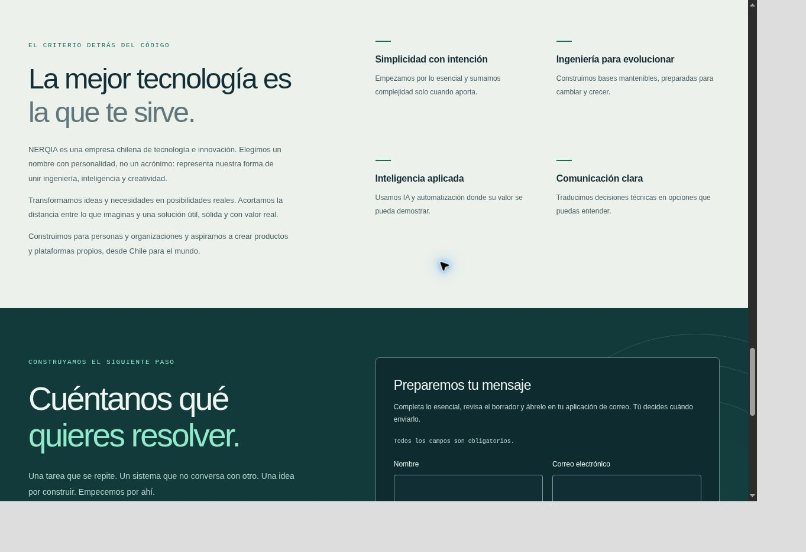

# NERQIA Site V1.2 · Comunicación de marca y redes

## Diagnóstico y alcance

Inspección del 4 de noviembre de 2026 sobre `main@b40a5b3d39c4eb50881744fdff2a766491e10a73`. La base ya incluye el logotipo oficial, 31 recursos de marca reproducibles, el dominio de producción, el correo corporativo actual, tres perfiles sociales, ejemplos, valores y un formulario que prepara un borrador local. `npm ci` y el `npm run check` inicial pasan: 40 pruebas en cuatro archivos.

Las barreras del encargo son de comunicación: no se explicaba el nombre y propósito de NERQIA, el CTA hablaba de un proyecto ya definido, los ejemplos enumeraban capacidades y las redes eran enlaces de texto pequeños. El feedback del visitante se trata como observación cualitativa, sin atribuir estadísticas ni mejoras de conversión medidas.

La intervención se integra en las ocho secciones existentes: tres párrafos junto a los valores, las mismas cuatro tarjetas de ejemplos y el mismo contacto. No se añade página Nosotros, sección duplicada, carrusel ni barra social. Header, titular y composición del hero, logo, fuentes, tokens, animaciones, formulario, privacidad, productos, dominio y workflow se conservan.

## Cambios por archivo

| Archivo                                          | Cambio                                                                                                                                                                          |
| ------------------------------------------------ | ------------------------------------------------------------------------------------------------------------------------------------------------------------------------------- |
| `src/content/copy.ts`                            | Historia de marca, propósito y aspiración desde Chile; contacto abierto a orientación; ejemplos antes/solución/resultado esperado; redes y metadescripciones, con paridad ES/EN |
| `src/components/sections/Sections.tsx`           | Narrativa dentro de Why y una frase de orientación en Contact                                                                                                                   |
| `src/components/sections/PracticalSolutions.tsx` | Las cuatro tarjetas usan listas de definición accesibles para sus tres etapas                                                                                                   |
| `src/config/site.ts`                             | Identificador tipado para cada red; URLs, orden, correo y política de productos preservados                                                                                     |
| `src/components/layout/Footer.tsx`               | Iconos y nombres visibles, nombres accesibles localizados, invitación secundaria y `noopener noreferrer`                                                                        |
| `src/components/ui/SocialIcon.tsx`               | Tres SVG monocromos locales reutilizables, decorativos y sin IDs ni recursos remotos                                                                                            |
| `src/styles/index.css`                           | Reglas puntuales para narrativa, etapas de ejemplos y enlaces sociales adaptables con altura mínima de 44 px                                                                    |
| `tests/BrandStorySocial.test.tsx`                | Siete casos adicionales que cubren ambos idiomas, perfiles/URLs, SVG, narrativa, ejemplos, orientación sin transporte y productos ocultos                                       |
| `README.md`                                      | Referencia a V1.2 y nueva forma tipada de la configuración social                                                                                                               |
| Este documento, licencia y capturas              | Procedencia, decisiones, validación y comparativas                                                                                                                              |

NERQIA se presenta como empresa chilena de tecnología e innovación. El nombre se explica como una elección con personalidad, sin inventar un acrónimo. El propósito y la aspiración a productos propios se comunican conceptualmente, sin publicar proyectos internos ni fechas de lanzamiento. Se conserva «Tecnología que trabaja para ti» y el descriptor.

El CTA secundario pasa a «Cuéntanos tu idea» y el contacto expresa «No necesitas saber cómo resolverlo. Podemos descubrirlo juntos». El formulario mantiene `other` / Necesito orientación, sus cuatro campos, validación, borrador, copia y apertura del correo. Se ajustan las etiquetas y asuntos para admitir ideas o consultas; no se cambian los límites ni la lógica de envío.

Los ejemplos muestran un profesional con fechas dispersas, una librería que reúne ventas e inventario, un negocio con pedidos duplicados y una organización que necesita seguimiento. Todos siguen identificados como posibilidades; los beneficios son esperados, sin clientes, testimonios ni cifras de éxito inventados.

## Procedencia de los SVG sociales

Se incorporan únicamente los contornos de Instagram, Facebook y TikTok de **Simple Icons 15.20.0**, distribución npm `simple-icons@15.20.0`, licencia **CC0-1.0**, incluida en [licenses/simple-icons-CC0.md](licenses/simple-icons-CC0.md). Fuente: https://www.npmjs.com/package/simple-icons/v/15.20.0.

Se conservan los `path` originales y el `viewBox="0 0 24 24"`; la presentación monocroma usa `currentColor` y los tokens existentes. Se utiliza un componente separado del Icon lineal para no aplicar trazos a glifos de marca rellenos. Los SVG tienen dimensiones explícitas de 20×20, `aria-hidden`, `focusable=false`, sin títulos redundantes, scripts, imágenes, IDs, fuentes ni peticiones externas.

El paquete se descargó como fuente de datos con `npm pack --ignore-scripts` fuera del proyecto. No se agregó a `package.json` ni al lockfile. SHA-256 del archivo de distribución: `27668faa4e43cea62842e0415f6c7a6bc3c704f66d89c413958ebe3d62563664`.

| SVG original    | SHA-256                                                            |
| --------------- | ------------------------------------------------------------------ |
| `instagram.svg` | `f53af2d1fc5292ba1433b5c1faf50005ce6a997fa302d1816989929f379a59dc` |
| `facebook.svg`  | `b06d18d844ed621b89faffb1a33440cc0ec4f1ffea9f36191f50db19a47c59a6` |
| `tiktok.svg`    | `6f54ac8d325faacea8935bdc44cbed60206a6b408641799e5fea1cba7c1a0af7` |

Las URLs corporativas permanecen exclusivamente en `site.socials`. El footer utiliza un nombre visible y un nombre accesible en cada idioma; el SVG es decorativo. Si se vacía la lista, también desaparecen la invitación y el landmark social. No hay SDK, widgets, analítica ni píxeles.

## Verificación ejecutada

| Verificación                                                        | Resultado                                             |
| ------------------------------------------------------------------- | ----------------------------------------------------- |
| `npm ci`                                                            | Correcto, lockfile sin cambios                        |
| `npm run brand:check`                                               | 31 recursos de marca idénticos a su maestro           |
| `npm run lint`                                                      | Correcto, sin advertencias de lint                    |
| `npm run typecheck`                                                 | Correcto                                              |
| `npm test`                                                          | 47 pruebas en cinco archivos, correctas               |
| `npm run check`                                                     | Correcto; ejecuta marca, lint, tipos, pruebas y build |
| Build de producción `https://www.nerqiaspa.com` y raíz `/`          | Correcto; HTML y metadatos bilingües verificados      |
| Build `https://bodegafresh.github.io/nerqia-site` y `/nerqia-site/` | Correcto; rutas y SEO verificados                     |
| `git diff --check`                                                  | Correcto                                              |

Los 40 tests anteriores se conservan. Los nuevos comprueban URLs provenientes de la configuración (incluido cambio de URL en un fixture y lista vacía), selección de los tres glifos diferentes, nombres de enlace, seguridad de pestaña nueva, SVG decorativos, presencia de narrativa y etapas de ejemplos, ocho secciones, productos ocultos y orientación con borrador sin `fetch` ni almacenamiento.

Revisión Chrome sobre el build de producción: anchos nominales **320/360/390/768/1024/1280/1440**, ES y EN, mediante iframes de QA. La barra vertical ocupa 15 px: el ancho CSS útil es el nominal menos 15 px. Las 14 combinaciones tienen `scrollWidth === clientWidth`, ocho secciones, cuatro ejemplos, tres perfiles, imágenes cargadas y productos ocultos. Todos los iconos miden 20×20 y sus enlaces alcanzan como mínimo 44×44 px.

Se inspeccionaron hero, ejemplos, narrativa y footer. A 1280 nominales, header (90 px), hero (697,48 px), problemas, servicios y audiencias mantienen sus dimensiones. El contenido adicional aumenta la altura completa aproximadamente de 5538 a 6016 px, sin secciones nuevas ni cambio de composición. El JS de producción pasa de 82,83 a 85,82 kB gzip y el CSS de 6,19 a 6,32 kB gzip; no hay dependencias nuevas.

Se comprobaron con teclado los enlaces TikTok → Instagram → Facebook, con outline menta visible de 3 px. El menú móvil abre, enfoca Cerrar, avanza con Tab y cierra con Escape devolviendo el foco. En móvil se preparó una solicitud de orientación con datos sintéticos `qa@example.org`, se inspeccionó su borrador y enlace `mailto:`, y se borraron los campos. No se abrió un cliente de correo ni se envió un mensaje. La suite existente cubre también copia, alternativa manual, validación, borrado e hidratación.

Se cargó EN bajo `/nerqia-site/en/` y se cambió a ES: logos, favicon, canonical y enlaces respetan el prefijo. Los perfiles sociales siguen siendo enlaces HTTPS normales con nombres localizados. Contrastes de las combinaciones nuevas: texto social/navy **9,14:1**, etiquetas teal/papel **5,57:1**, narrativa/papel **5,68:1** y orientación/fondo de contacto **11,25:1**.

## Capturas

Las capturas corresponden al build real en el contenedor de QA. El margen gris de las vistas móviles pertenece al harness, no al sitio.

| Área                           | Antes                                   | Después                                  |
| ------------------------------ | --------------------------------------- | ---------------------------------------- |
| Header y hero, escritorio      | [Antes](v1.2/before-hero.jpg)           | [Después](v1.2/after-hero.jpg)           |
| Ejemplos, escritorio           | [Antes](v1.2/before-examples.jpg)       | [Después](v1.2/after-examples.jpg)       |
| Valores e historia, escritorio | [Antes](v1.2/before-story.jpg)          | [Después](v1.2/after-story.jpg)          |
| Footer, escritorio             | [Antes](v1.2/before-footer-desktop.jpg) | [Después](v1.2/after-footer-desktop.jpg) |
| Footer, móvil                  | [Antes](v1.2/before-footer-mobile.jpg)  | [Después](v1.2/after-footer-mobile.jpg)  |



## Revisión en Fedora y límites

Con Node >=22.12 (24 recomendado), desde el repositorio:

```bash
git fetch origin
git switch feat/nerqia-brand-story-social-refinement
git pull --ff-only
npm ci
npm run check
npm run dev
```

Revisar ES/EN, historia junto a los valores, cuatro ejemplos, orientación y footer; recorrer sus enlaces con Tab. `npm run brand:check` debe seguir sin diferencias. Para reproducir el caso Pages:

```bash
VITE_SITE_URL=https://bodegafresh.github.io/nerqia-site \
VITE_BASE_PATH=/nerqia-site/ npm run build
```

La revisión visual se limita a Chrome; no se probaron dispositivos físicos, Safari, Firefox ni tecnologías de asistencia dedicadas. Las comprobaciones de contraste y teclado no equivalen a certificación WCAG ni a una puntuación Lighthouse. Se validaron las URLs configuradas y atributos de enlace; no se probaron sesiones de las redes externas ni entrega real de correo.

Se conserva el workflow de Pages. La CI remota y el estado del PR se informan en su descripción; esta rama no se fusiona ni habilita auto-merge y no se despliega manualmente.
